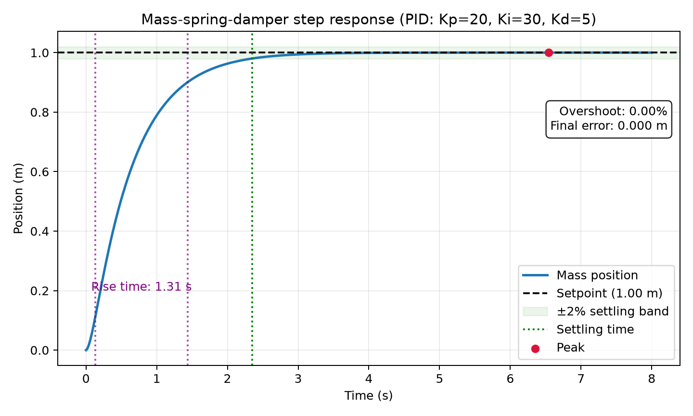
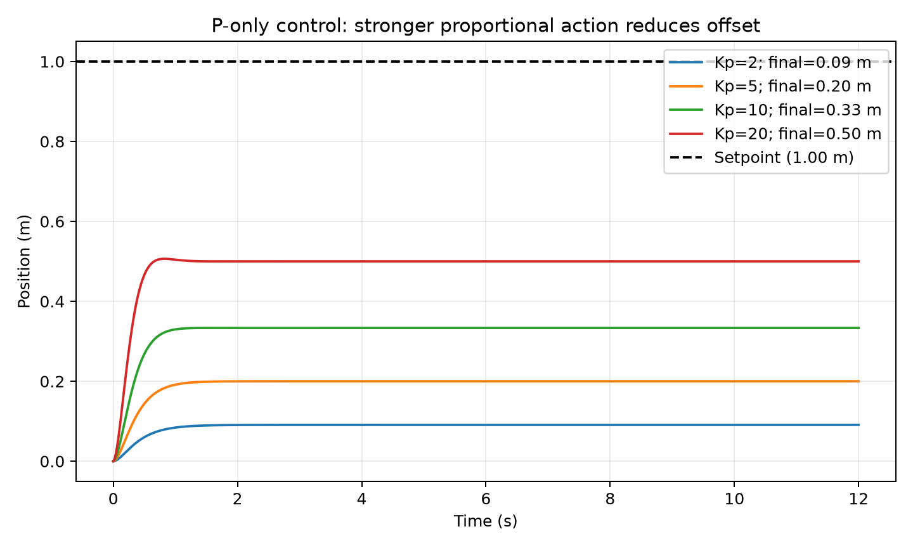
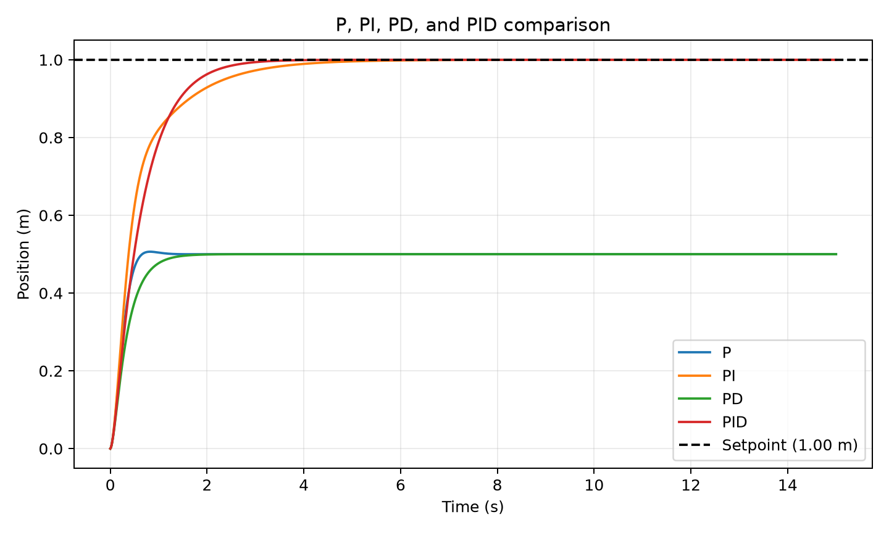
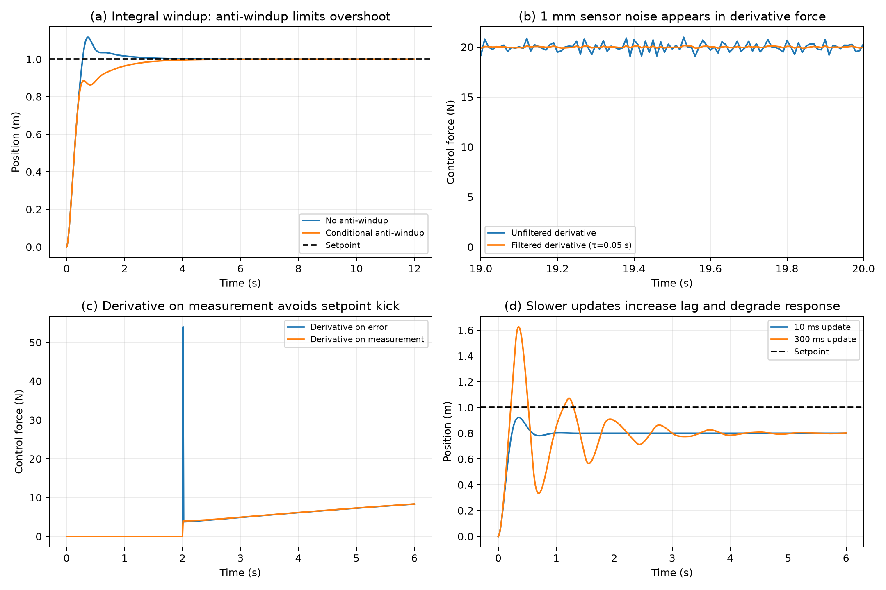
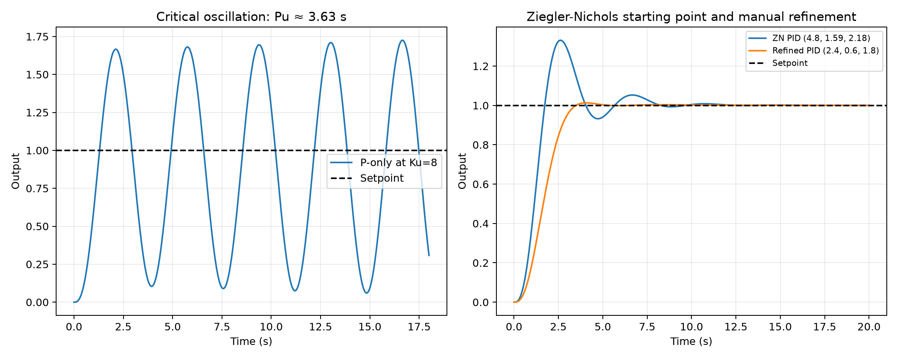

# PID Control

### A beginner-friendly introduction, simulation, and tuning study

**Physical AI | Internship assignment**  
**Plant:** 1 kg mass–spring–damper system | **Target position:** 1 m

---

## Abstract

A proportional–integral–derivative (PID) controller adjusts a machine's input using the current error, accumulated past error, and the rate at which error changes. This report introduces those three actions, models the assignment's mass–spring–damper plant, and evaluates controller behavior with reproducible Python simulations. It also demonstrates actuator saturation, sensor noise, derivative kick, slow sampling, and Ziegler–Nichols tuning on the separate plant \(G(s)=1/(s+1)^3\).

The simulation is intentionally simple: NumPy and Matplotlib are used, while the PID logic and plant models are implemented directly in Python. Run `python src/pid_assignment.py` from the repository root to regenerate the figures and the controller-metrics CSV.

## 1. The basic idea

A feedback controller repeatedly compares a **setpoint** (the target) with a sensor measurement. Their difference is the **error**:

\[
e(t)=r(t)-y(t)
\]

Here, \(r(t)\) is the setpoint and \(y(t)\) is the measured output. The controller turns the error into an actuator command; the machine, or **plant**, responds; and a sensor reports the result back to the controller.

Think of adjusting shower taps. If the water is colder than desired, you add hot water; when it gets close to the desired temperature, you make smaller adjustments. A robot controller repeats that comparison and adjustment automatically.

**Feedback loop:** Setpoint → Controller → Actuator → Plant → Sensor → measured output back to Controller.

The loop is closed because the measurement affects the next control action. PID is one common way to calculate that action; it is not a guarantee of stability or perfect performance. The gains must suit the plant.[1]

## 2. The PID formula

The continuous-time PID law is:

\[
u(t)=K_p e(t)+K_i\int_0^t e(\tau)\,d\tau+K_d\frac{de(t)}{dt}
\]

For this assignment, \(u\) is force in newtons and position error is in metres. The corresponding gain units are:

| Quantity | Meaning | Unit in this position-control example |
|---|---|---|
| \(e\) | Target position minus measured position | m |
| \(u\) | Actuator force | N |
| \(K_p\) | Proportional gain | N/m |
| \(K_i\) | Integral gain | N/(m·s) |
| \(K_d\) | Derivative gain | N·s/m |

### What the terms do

- **P — present error:** \(K_p e(t)\) pushes in proportion to the current gap. Increasing \(K_p\) usually strengthens the response, but can also increase overshoot or instability.
- **I — accumulated error:** \(K_i\int e(t)\,dt\) builds a correction when error persists. It can remove steady-state offset, but excessive accumulation during actuator saturation causes **integral windup**.
- **D — error trend:** \(K_d\,de/dt\) responds to how quickly error is changing and can add damping. A raw derivative also amplifies rapid sensor noise.

At sample \(k\), a basic digital implementation uses:

\[
e_k=r_k-y_k,\quad I_k=I_{k-1}+e_k\Delta t,\quad
D_k=\frac{e_k-e_{k-1}}{\Delta t},\quad
u_k=K_p e_k+K_i I_k+K_dD_k.
\]

The implementation in this project uses derivative-on-measurement to avoid a setpoint kick. For a fixed setpoint, that derivative is \(-\Delta y/\Delta t\), so the output is \(K_p e+K_iI-K_d(\Delta y/\Delta t)\). It also filters the derivative when requested and uses conditional integration for anti-windup.

## 3. The test system

The assignment's plant is a 1 kg mass attached to a spring and damper. Newton's second law gives:

\[
m\ddot{x}+c\dot{x}+kx=F
\]

where \(x\) is position, \(F\) is the actuator force, \(m=1\ \text{kg}\), \(c=10\ \text{N·s/m}\), and \(k=20\ \text{N/m}\). The target is \(r=1\ \text{m}\).

The spring pulls toward its rest position with force magnitude \(F_s=kx\). At \(x=1\ \text{m}\), the spring pulls back with \(20\ \text{N}\). At rest, the actuator must therefore provide \(20\ \text{N}\) in the opposite direction to hold the mass at the target. The damper force is proportional to velocity and is zero once the mass is stationary.

The simulation uses a fixed \(0.01\ \text{s}\) plant-integration step. Unless a figure explicitly varies the controller update period, the controller updates at the same interval.

## 4. How to judge a result

The report uses four response measures:

1. **Rise time:** time from 10% to 90% of the response's final change.
2. **Overshoot:** amount the response exceeds the setpoint, as a percentage of the setpoint.
3. **Settling time:** first time after which the response remains within ±2% of its final value.
4. **Steady-state error:** setpoint minus the final simulated output.

For a positive setpoint, overshoot is

\[
M_p=\max\left(0,\frac{x_{\max}-r}{|r|}\right)\times100\%.
\]

Rise and settling times are measured relative to the response's final value; steady-state error is reported separately so a P-only controller can have a finite settling time while still stopping short of the target. The graph below marks the rise interval, settling band and time, peak, overshoot, and final error.



*Figure 1. The selected mass–spring–damper PID response: \(K_p=20\), \(K_i=30\), \(K_d=5\). Position is in metres and time is in seconds.*

## 5. Each part alone

### P-only: why a residual error remains

With P-only control, \(F=K_p(r-x)\). At steady state, velocity and acceleration are zero, so the actuator force balances the spring:

\[
K_p(r-x)=kx
\quad\Longrightarrow\quad
x=\frac{K_p}{K_p+k}r,\qquad
e_{ss}=\frac{k}{K_p+k}r.
\]

For \(r=1\ \text{m}\) and \(k=20\ \text{N/m}\):

| \(K_p\) (N/m) | Predicted final position (m) | Steady-state error (m) |
|---:|---:|---:|
| 2 | 0.091 | 0.909 |
| 5 | 0.200 | 0.800 |
| 10 | 0.333 | 0.667 |
| 20 | 0.500 | 0.500 |

For any finite positive \(K_p\), the error is nonzero. Increasing \(K_p\) reduces it but does not eliminate it. The simulated final positions agree with this equilibrium calculation.



*Figure 2. Four P-only responses. Each curve approaches its predicted equilibrium below the 1 m setpoint; stronger proportional gain reduces the offset.*

### Adding I and D

The P/PI/PD/PID comparison isolates the terms while keeping \(K_p=20\ \text{N/m}\) consistent:

- **P:** fast response, but a 0.5 m steady-state error.
- **PI:** integral action removes the offset.
- **PD:** derivative action damps the transient, but cannot provide the spring's required steady holding force; the 0.5 m offset remains.
- **PID:** integral action removes the offset while derivative action damps the response.

The selected comparison gains are PI \((20,30,0)\), PD \((20,0,5)\), and PID \((20,30,5)\), in \((K_p,K_i,K_d)\) order.

## 6. P, PI, PD, and PID together

The following numerical metrics were calculated from the same deterministic simulation used to draw the comparison figure. Rise time is 10–90% of the final change; settling time uses a ±2% band around the final value. The final error is the signed target-minus-final-position value.

| Controller | \(K_p\) | \(K_i\) | \(K_d\) | Rise (s) | Overshoot (%) | Settle (s) | Final error (m) |
|---|---:|---:|---:|---:|---:|---:|---:|
| P | 20 | 0 | 0 | 0.39 | 0.00 | 0.59 | 0.500 |
| PI | 20 | 30 | 0 | 1.52 | 0.00 | 3.33 | 0.000 |
| PD | 20 | 0 | 5 | 0.69 | 0.00 | 1.25 | 0.500 |
| PID | 20 | 30 | 5 | 1.31 | 0.00 | 2.35 | 0.000 |

The rounded values in the table are generated in `results/controller_metrics.csv`. The PID choice is a reasonable compromise for this demonstration: it reaches the target with negligible final error and no visible overshoot, while settling sooner than the PI case. These gains are illustrative for this model, not universal settings.



*Figure 3. Controller comparison for the same plant and setpoint. Position is in metres and time is in seconds.*

## 7. Real-world problems and fixes

The next figure uses the same mass–spring–damper plant to illustrate four implementation issues. The sensor-noise case uses a fixed random seed so that the comparison is repeatable.



*Figure 4. (a) Conditional integration lowers peak position from 1.117 m to 1.000 m with a 30 N force limit. (b) Filtering reduces steady-state control-force standard deviation from 0.458 N to 0.067 N with ±1 mm sensor noise. (c) Derivative-on-measurement limits the setpoint-step force from 54.02 N to 4.02 N. (d) With P-only \(K_p=80\), changing the update period from 10 ms to 300 ms increases peak position from 0.923 m to 1.626 m and settling time from 0.77 s to 4.05 s.*

### (a) Integral windup

When the actuator saturates, extra controller demand cannot produce extra force. If the integral continues accumulating, it can remain large after the output leaves saturation and drive the response past the target. Figure 4(a) compares ordinary integration with conditional integration at a 30 N force limit. The peak drops from 1.117 m (11.66% overshoot) to 1.000 m (no overshoot in the sampled response). Conditional integration stops accumulating error when that error would push further into saturation.

### (b) Noisy sensor

Taking a derivative magnifies rapid changes. The sensor-noise example adds repeatable, zero-mean uniform noise bounded by ±1 mm and compares an unfiltered derivative with a first-order filtered derivative (\(\tau=0.05\ \text{s}\)). Over the plotted final second, filtering reduces force standard deviation from 0.458 N to 0.067 N (about 85%). It also adds some lag, so the filter should not be made arbitrarily slow.

### (c) Derivative kick

At \(t=2\ \text{s}\), the setpoint steps from 0 to 1 m. With derivative-on-error, the error changes by 1 m in one 0.01 s sample. For \(K_d=0.5\ \text{N·s/m}\), this creates an approximately \(0.5(1/0.01)=50\ \text{N}\) derivative contribution in that sample. The plotted peak force is 54.02 N with derivative-on-error versus 4.02 N with derivative-on-measurement, which does not differentiate the setpoint.

### (d) Slow update

The plant continues evolving between controller updates. For the matched P-only example in Figure 4(d), increasing the update period from 10 ms to 300 ms changes the peak from 0.923 m (no overshoot) to 1.626 m (62.6% overshoot); settling time increases from 0.77 s to 4.05 s. This illustrates how stale measurements can degrade damping; sufficiently slow sampling can destabilize a loop.

## 8. Choosing the gains

### Manual tuning

A cautious manual sequence is:

1. Set \(K_i=K_d=0\). Increase \(K_p\) until the response is usefully quick while remaining stable.
2. Add \(K_i\) gradually to reduce steady-state error. Watch for overshoot and actuator saturation.
3. Add \(K_d\) if more damping is needed. Filter the derivative when measurements are noisy.
4. Compare rise time, overshoot, settling time, final error, and control effort; adjust one change at a time.

The common tendencies are trade-offs, not laws for every plant: higher \(K_p\) often speeds response, higher \(K_i\) removes offset but increases windup risk, and higher \(K_d\) can add damping but increases noise sensitivity.

### Ziegler–Nichols on \(G(s)=1/(s+1)^3\)

For unity feedback with P-only control, the closed-loop characteristic polynomial is

\[
(s+1)^3+K_p=s^3+3s^2+3s+(1+K_p).
\]

At the stability boundary, the Routh condition gives \(K_u=8\). The imaginary-axis frequency is \(\omega_u=\sqrt{3}\ \text{rad/s}\), so

\[
P_u=\frac{2\pi}{\omega_u}=\frac{2\pi}{\sqrt3}\approx3.63\ \text{s}.
\]

The simulation confirms sustained P-only oscillation near that critical gain. The classic Ziegler–Nichols parallel-PID settings are \(K_p=0.6K_u\), \(K_i=1.2K_p/P_u\), and \(K_d=K_pP_u/8\).[2] They give approximately \(K_p=4.80\), \(K_i=1.59\), and \(K_d=2.18\). On this simulated plant, the resulting response has about 33.1% overshoot and a 7.70 s settling time.

The plotted manual refinement, \(K_p=2.4\), \(K_i=0.6\), \(K_d=1.8\), reduces simulated overshoot to about 1.31% and settling time to about 3.23 s. It is slower to rise than the raw Ziegler–Nichols tuning, illustrating the speed-versus-overshoot trade-off. This refinement is specific to the assignment's ideal model.



*Figure 5. Left: sustained oscillation near \(K_u=8\), with period \(P_u\approx3.63\ \text{s}\). Right: the Ziegler–Nichols starting point and a manually refined response for \(G(s)=1/(s+1)^3\).*

## 9. Reusable implementation and reproduction

The implementation is in `src/pid_assignment.py`. It contains a reusable `PIDController`, a mass–spring–damper simulator, a separate three-pole simulator, metric calculations, and plotting functions. It does not import a control-system library. The controller includes:

- derivative-on-measurement as the default to avoid setpoint kick;
- an optional first-order derivative filter;
- actuator output limits; and
- conditional integration to limit windup.

From the repository root, install the declared dependencies and regenerate all figures and metrics:

```powershell
python -m pip install -e .
python src\pid_assignment.py
```

Outputs are written to `results/`. Figures have titles, labelled axes with units where applicable, legends, and explanatory captions in this report. `results/controller_metrics.csv` contains the exact comparison values before rounding.

## 10. Real robots and common myths

### Examples

- **Motor speed:** a controller adjusts motor voltage or current to track a speed target as load changes.
- **Drone attitude:** separate loops can regulate roll, pitch, and yaw rates or angles.
- **Robot arm:** joint controllers track angle targets despite inertia and changing loads.
- **Line-following robot:** a controller uses lateral line error to steer toward the line.
- **Cruise control:** a vehicle adjusts throttle to reduce speed error on hills and under changing drag.

These are examples of feedback-control uses; actual products may use cascaded loops, feedforward, filtering, and other techniques in addition to PID.

### Common myths

1. **“PID is magic.”** It is a defined feedback law; performance depends on the plant, actuator, sensors, sampling, and tuning.
2. **“More gain is always better.”** More aggressive gains can cause overshoot, oscillation, saturation, or instability.
3. **“Integral fixes everything.”** Integral action can remove steady-state offset, but can also wind up and slow recovery.
4. **“Derivative always improves the response.”** Derivative can add damping, but it amplifies high-frequency measurement noise.
5. **“A tuned controller never needs revisiting.”** Changes in load, friction, temperature, or operating conditions can change the response.

## Conclusion

PID combines a response to the present error (P), accumulated error (I), and the error trend (D). In the assignment's spring system, P alone leaves an analytically predictable position error because the spring needs a holding force. Integral action supplies that missing steady force; derivative action can damp motion, but needs care around noise and setpoint changes. The simulations make those effects measurable rather than relying on vague claims.

## References

1. University of Michigan, Control Tutorials for MATLAB and Simulink, [“PID Control”](https://ctms.engin.umich.edu/CTMS/index.php?example=Introduction&section=ControlPID). Introductory feedback-control and PID reference.
2. J. G. Ziegler and N. B. Nichols, “Optimum Settings for Automatic Controllers,” *Transactions of the ASME*, vol. 64, pp. 759–768, 1942. Source of the classic ultimate-gain tuning rules.
3. Modern Monk Labs, “Intern Assignment: PID Control,” supplied assignment brief, included at `docs/assignment/PID_Intern_Assignment-1.pdf`.

## AI usage statement

AI tools assisted with organizing the explanation and reviewing clarity. The equations, controller implementation, simulation outputs, and plotted results are included in this repository so the work can be inspected and reproduced.
